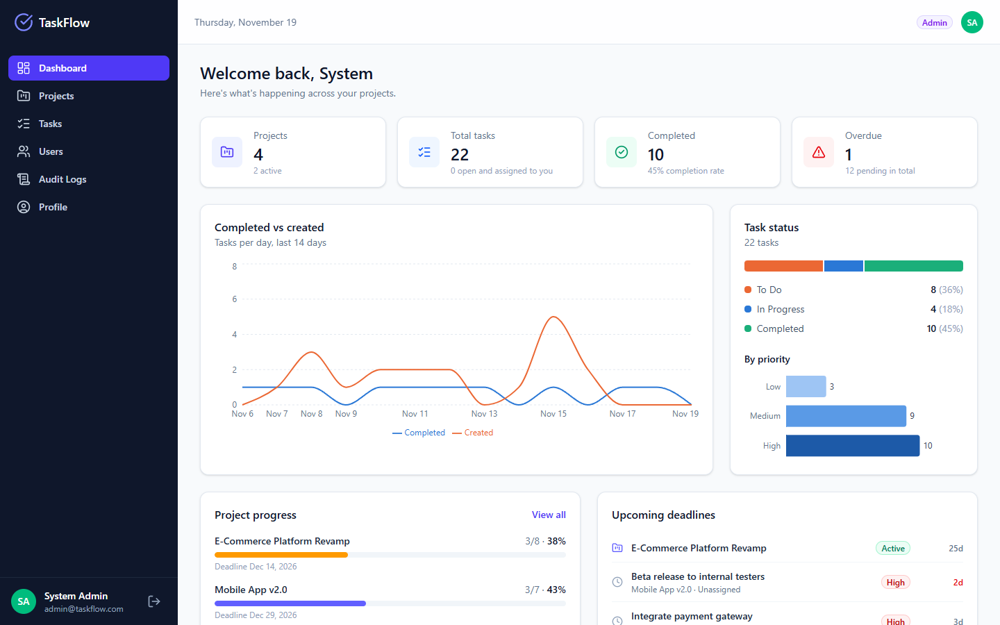
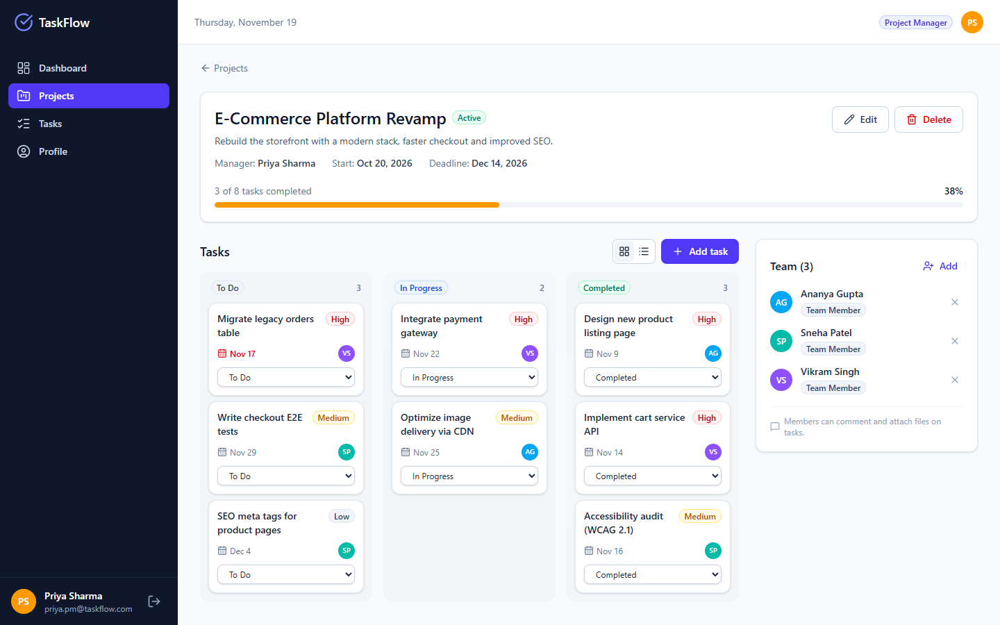
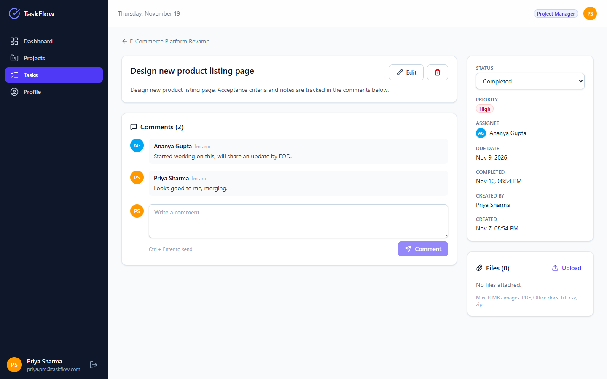
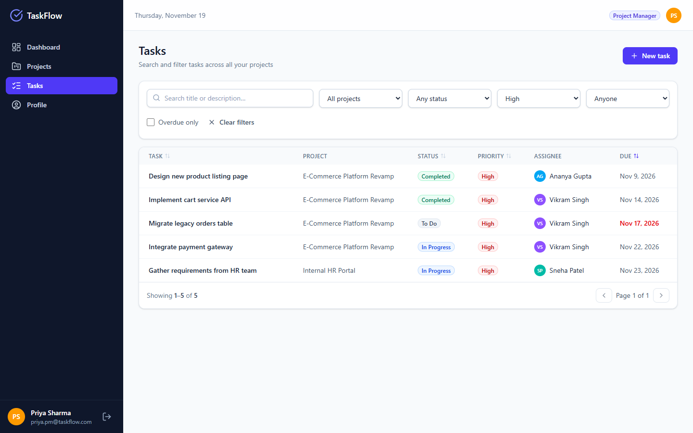
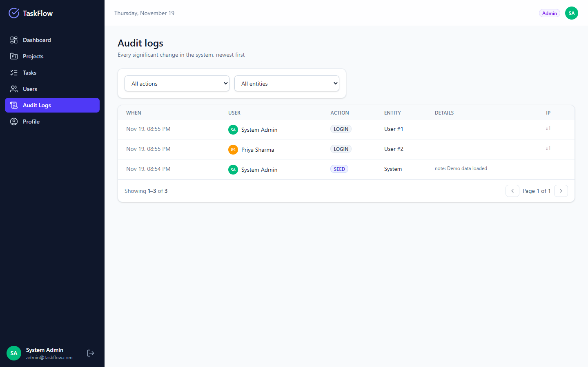

# TaskFlow: Project & Task Management System

A full-stack web application that lets organizations manage **projects, teams and tasks** with role-based access control, task tracking, comments, file attachments, audit logging and an analytics dashboard.



| | |
|---|---|
| **Live demo** | `<add your deployment URL here>` (see [Deployment](#deployment)) |
| **API docs (Swagger)** | `/api/docs` on any running instance, e.g. <http://localhost:5000/api/docs> |
| **Postman collection** | [`docs/TaskFlow.postman_collection.json`](docs/TaskFlow.postman_collection.json) |
| **Database schema** | [`docs/schema.sql`](docs/schema.sql) |
| **ER diagram** | [`docs/ER-diagram.md`](docs/ER-diagram.md) · [PNG](docs/ER-diagram.png) |

---

## Contents
1. [Features](#features)
2. [Tech stack](#tech-stack)
3. [Architecture](#architecture)
4. [Getting started](#getting-started)
5. [Demo accounts](#demo-accounts)
6. [Roles & permissions](#roles--permissions)
7. [API overview](#api-overview)
8. [Testing](#testing)
9. [Docker](#docker)
10. [Deployment](#deployment)
11. [Project structure](#project-structure)
12. [Design decisions & trade-offs](#design-decisions--trade-offs)

---

## Features

### Functional requirements

| Requirement | Implementation |
|---|---|
| **User registration & login** | `POST /auth/register`, `POST /auth/login`; register / sign-in pages with client + server validation |
| **JWT authentication** | Bearer tokens (HS256, 1-day expiry). The user is reloaded on every request, so role changes and deactivation take effect immediately |
| **Role-based access** (Admin, Project Manager, Team Member) | `authorize()` route guards + resource-level checks in `utils/access.js`; the UI hides actions you can't perform |
| **Create / update / delete projects** | Full CRUD; deleting a project cascades to its tasks, comments and attachment files |
| **Assign project managers** | A PM automatically manages projects they create; an Admin can assign or reassign any PM |
| **Add team members** | Searchable multi-select; removing a member un-assigns their tasks in that project |
| **Set project deadlines** | Start date + deadline (validated deadline ≥ start); overdue deadlines are highlighted |
| **Create / assign / edit / delete tasks** | Assignees must belong to the project team |
| **Task priority** (Low / Medium / High) | Enum, filterable, sortable |
| **Task status** (To Do / In Progress / Completed) | Kanban board + list view. `completedAt` is tracked automatically |
| **Due dates** | Overdue tasks are flagged; `?overdue=true` filter |
| **Task comments** | Threaded per task; authors (or the project manager) can delete |
| **File attachments** | Upload / download / delete. 10 MB limit, extension allow-list, random server-side filenames |
| **Dashboard** | Project progress, task statistics, upcoming deadlines, completed vs created trend (14 days), team performance table |

### Technical requirements

| Requirement | Implementation |
|---|---|
| **Responsive UI** | Tailwind CSS; collapsible sidebar, mobile card layouts, horizontally scrollable tables. Checked for no horizontal overflow at 390 px |
| **RESTful APIs** | Resource-oriented routes, correct verbs and status codes (200/201/400/401/403/404/409), consistent JSON envelope |
| **Input validation** | Joi schemas on every body, query and path parameter. Unknown fields are stripped; all errors are returned per field |
| **Exception handling** | Central error middleware maps Joi / Sequelize / Multer / JSON-parse errors to clean responses. Stack traces never leak in production |
| **Search, filter & pagination** | Users, projects, tasks and audit logs: `?search=&page=&limit=&sort=field:dir` plus entity-specific filters |
| **Audit logs** | Every create / update / delete / status change / login, with the user, IP and a before → after diff; Admin-only viewer |
| **Secure password hashing** | bcrypt (10 rounds); hashes are excluded from every query by default. Strong-password policy |
| **API documentation** | OpenAPI 3 spec served through Swagger UI at `/api/docs` (+ `/api/docs.json`) |
| **Unit testing** | Jest + Supertest: **65 tests**, ~88% line coverage. Each suite runs against an isolated in-memory DB |
| **Docker support** | Multi-stage `Dockerfile` + `docker-compose.yml` (app + PostgreSQL 16) |

**Extras:** Helmet security headers, rate limiting on auth endpoints, CORS config, graceful shutdown, health check endpoint, URL-synced task filters (shareable links), demo data seeder, Render blueprint for one-click deploy.

---

## Tech stack

| Layer | Technology |
|---|---|
| Frontend | React 19, Vite, React Router 7, Tailwind CSS 4, Recharts, Axios, lucide-react, react-hot-toast |
| Backend | Node.js 22, Express 5, Sequelize 6 ORM |
| Database | **PostgreSQL** (Docker / production) · **SQLite** (zero-setup local dev & tests) |
| Auth / security | jsonwebtoken, bcryptjs, helmet, express-rate-limit, cors |
| Validation / uploads | Joi, Multer |
| Docs / tests | OpenAPI 3 + swagger-ui-express, Jest, Supertest |
| DevOps | Docker, docker-compose, Render blueprint |

---

## Architecture

```
┌─────────────────────┐   HTTPS / JSON + JWT   ┌──────────────────────────────────────────┐
│  React SPA (Vite)   │ ─────────────────────▶ │ Express API (/api)                        │
│  pages / components │                        │  routes → validate(Joi) → authenticate    │
│  AuthContext, Axios │ ◀───────────────────── │  → authorize(role) → controller           │
└─────────────────────┘                        │  → access.js (resource rules) → Sequelize │
                                               │  → audit log         errorHandler (last)  │
                                               └───────────────┬──────────────────────────┘
                                                               │
                                              PostgreSQL / SQLite      uploads/ (attachments)
```

In production, the Express server also serves the built React app, so the whole system deploys as **one service plus one database**.

---

## Getting started

**Prerequisites:** Node.js ≥ 18 (tested on 22). No database install is needed for local dev: it uses SQLite by default.

```bash
# 1. Backend
cd backend
npm install
cp .env.example .env        # defaults work out of the box (SQLite)
npm run seed                # optional: loads demo users, projects, tasks & comments
npm run dev                 # API on http://localhost:5000  (Swagger: /api/docs)

# 2. Frontend (new terminal)
cd frontend
npm install
npm run dev                 # UI on http://localhost:5173  (proxies /api to :5000)
```

**Single-port mode** (as in production): `cd frontend && npm run build`, then `cd ../backend && npm start`, and open <http://localhost:5000>.

**Using PostgreSQL locally:** set `DB_DIALECT=postgres` and either `DATABASE_URL` or `DB_HOST/DB_PORT/DB_NAME/DB_USER/DB_PASSWORD` in `backend/.env`. Tables are created on startup.

### Environment variables (`backend/.env`)

| Variable | Default | Description |
|---|---|---|
| `PORT` | `5000` | API port |
| `DB_DIALECT` | `sqlite` | `sqlite` or `postgres` |
| `SQLITE_STORAGE` | `./data/dev.sqlite` | SQLite file |
| `DATABASE_URL` | – | Postgres connection string (takes precedence over the `DB_*` vars) |
| `DB_SSL` | `false` | Enable SSL for managed Postgres |
| `JWT_SECRET` | – | **Required in production** |
| `JWT_EXPIRES_IN` | `1d` | Token lifetime |
| `CORS_ORIGIN` | `http://localhost:5173` | Comma-separated origins or `*` |
| `UPLOAD_DIR` / `MAX_FILE_SIZE_MB` | `./uploads` / `10` | Attachment storage |
| `ADMIN_EMAIL` / `ADMIN_PASSWORD` | `admin@taskflow.com` / `Admin@123` | Admin created on first boot if none exists |
| `SEED_DEMO` | `false` | `true` loads demo data on first boot when the DB is empty |

---

## Demo accounts

Available after `npm run seed` (or on a deployment with `SEED_DEMO=true`). The login page has one-click buttons for these.

| Role | Email | Password |
|---|---|---|
| Admin | `admin@taskflow.com` | `Admin@123` |
| Project Manager | `priya.pm@taskflow.com`, `rahul.pm@taskflow.com` | `Password@123` |
| Team Member | `ananya@`, `vikram@`, `sneha@`, `arjun@`, `kavya@taskflow.com` | `Password@123` |

---

## Roles & permissions

| Action | Admin | Project Manager | Team Member |
|---|:-:|:-:|:-:|
| Register / log in / edit own profile | ✅ | ✅ | ✅ |
| Manage users & roles, view audit logs | ✅ | – | – |
| Create projects | ✅ (any manager) | ✅ (becomes manager) | – |
| Edit / delete project, manage team | ✅ | ✅ own projects | – |
| Reassign a project's manager | ✅ | – | – |
| View project & its tasks | ✅ all | ✅ managed / member of | ✅ member of |
| Create / edit / delete / assign tasks | ✅ | ✅ own projects | – |
| Change task status | ✅ | ✅ own projects | ✅ tasks assigned to them |
| Comment / upload attachments | ✅ | ✅ | ✅ (project members) |
| Delete comment / attachment | ✅ | ✅ own projects | ✅ their own |

Resources the user can't see return **404** (not 403), so the existence of other teams' projects isn't leaked.

---

## API overview

Base URL `/api`. Every endpoint except register, login and health requires `Authorization: Bearer <token>`. Full request and response schemas are in **Swagger** (`/api/docs`).

| Method | Endpoint | Description |
|---|---|---|
| POST | `/auth/register` · `/auth/login` | Create account / obtain JWT |
| GET, PATCH | `/auth/me` | Current profile |
| POST | `/auth/change-password` | Change own password |
| GET, POST | `/users` | List (Admin, PM) / create (Admin) |
| GET, PATCH, DELETE | `/users/:id` | View / change role or status / deactivate |
| GET, POST | `/projects` | List (search, status, managerId, sort, paginate) / create |
| GET, PATCH, DELETE | `/projects/:id` | Details with members + stats / update / delete |
| POST | `/projects/:id/members` | Add team members |
| DELETE | `/projects/:id/members/:userId` | Remove a team member |
| GET, POST | `/tasks` | List (search, projectId, status, priority, assigneeId=`id\|me\|unassigned`, dueBefore/After, overdue, sort, paginate) / create |
| GET, PATCH, DELETE | `/tasks/:id` | Details / update / delete |
| GET, POST | `/tasks/:id/comments` | List / add comments |
| DELETE | `/comments/:id` | Delete a comment |
| GET, POST | `/tasks/:id/attachments` | List / upload (`multipart/form-data`, field `file`) |
| GET | `/attachments/:id/download` | Download a file |
| DELETE | `/attachments/:id` | Delete a file |
| GET | `/dashboard` | Aggregated statistics |
| GET | `/audit-logs` | Audit trail (Admin) |
| GET | `/health` | Health check |

**Response format**

```jsonc
// success (list)
{ "success": true, "data": [ ... ], "pagination": { "page": 1, "limit": 10, "total": 42, "totalPages": 5 } }
// error
{ "success": false, "message": "Validation failed", "errors": [{ "field": "email", "message": "email must be a valid email" }] }
```

**Postman:** import `docs/TaskFlow.postman_collection.json`, run **Auth → Login (Admin)** (the token is saved automatically), then call any request. Create requests store the new ids in collection variables.

---

## Testing

```bash
cd backend
npm test                 # 65 tests
npm run test:coverage    # with coverage report
```

| Suite | Covers |
|---|---|
| `auth.test.js` | registration (role can't be self-assigned), hashing, duplicate email, validation, login, deactivated users, JWT tampering, password change, user management RBAC, pagination |
| `projects.test.js` | CRUD, PM vs Admin manager rules, date validation, visibility scoping, search/filter, member add/remove (task unassignment), cascade delete, audit trail |
| `tasks.test.js` | task CRUD, assignee must be a member, status-only edits for members, `completedAt`, filters (`me`, `unassigned`, `overdue`), sorting & pagination, comments, attachments (type allow-list, download, ownership), dashboard aggregates |
| `unit.test.js` | pagination / sort helpers, Joi validators, error handler (malformed JSON, unknown routes), OpenAPI spec |

Tests run against an in-memory SQLite database, so they need no setup and are fully isolated.

---

## Docker

```bash
docker compose up --build
# App + API: http://localhost:5000      Swagger: http://localhost:5000/api/docs
# Postgres:  localhost:5432 (taskflow / taskflow)
```

To load demo data into the container DB: `docker compose exec app node src/seed.js`, or set `SEED_DEMO: "true"` under the `app` service before the first start.

The image is a multi-stage build: it compiles the React app, then runs the API (as the non-root `node` user) and serves the built UI. It includes a container `HEALTHCHECK`.

---

## Deployment

### Render (recommended, free tier): uses `render.yaml`
1. Push this repository to GitHub.
2. In Render: **New → Blueprint →** select the repository. Render creates the web service (Docker) **and** a PostgreSQL database, wiring `DATABASE_URL` and generating `JWT_SECRET`.
3. Enter an `ADMIN_PASSWORD` when prompted. `SEED_DEMO=true` loads the demo accounts on the first boot.
4. Open the service URL and add it to the top of this README.

### Any Docker host (Railway, Fly.io, a VPS…)
Build the root `Dockerfile` and provide `DB_DIALECT=postgres`, `DATABASE_URL` (plus `DB_SSL=true` for most managed Postgres), `JWT_SECRET` and `NODE_ENV=production`.

> **Note:** attachments are stored on the container's local disk. On free hosting tiers the disk is ephemeral, so uploaded files are lost on redeploy (their metadata stays). In production you would mount a persistent volume or move storage to S3 or Cloudinary. The upload middleware is the only place that would need to change.

---

## Project structure

```
.
├── backend/
│   ├── src/
│   │   ├── config/        # env config, DB connection, enums
│   │   ├── models/        # Sequelize models + associations
│   │   ├── middleware/    # auth (JWT + roles), validate (Joi), upload (Multer), errorHandler
│   │   ├── validators/    # Joi schemas for every endpoint
│   │   ├── controllers/   # auth, users, projects, tasks (+comments/attachments), dashboard, audit
│   │   ├── routes/        # route table
│   │   ├── utils/         # access rules, audit logger, pagination, search, ApiError
│   │   ├── docs/          # openapi.yaml
│   │   ├── app.js         # express app
│   │   ├── server.js      # bootstrap (DB sync, admin, listen, graceful shutdown)
│   │   └── seed.js        # demo data
│   └── tests/             # Jest + Supertest
├── frontend/
│   └── src/
│       ├── api/           # axios client + helpers
│       ├── context/       # AuthContext (user, role helpers)
│       ├── components/    # Layout, ui kit, ProjectForm, TaskForm, UserPicker
│       ├── pages/         # Dashboard, Projects, ProjectDetail, Tasks, TaskDetail, Users, AuditLogs, Profile, Auth
│       └── utils/
├── docs/                  # schema.sql, ER diagram, Postman collection, screenshots
├── Dockerfile · docker-compose.yml · render.yaml
```

---

## Design decisions & trade-offs

- **Sequelize with dual dialect.** PostgreSQL in production; SQLite for local dev and tests. Reviewers can run the project with `npm install` alone, and tests are fast and isolated. Dialect differences (ILIKE vs LIKE) are handled in `utils/search.js`.
- **Authorization lives in one module** (`utils/access.js`), so every endpoint applies the same rules. Route-level `authorize()` handles role gates, and resource-level checks handle ownership and membership.
- **Self-registration always creates a Team Member.** Elevated roles are granted only by an Admin, which prevents privilege escalation through the public endpoint.
- **Soft-deleting users** keeps comments, tasks and audit history intact.
- **Audit logging never breaks a request.** A failed audit write is logged, not thrown.
- **`sequelize.sync()`** creates tables on boot for simplicity. A larger codebase would use versioned migrations (`docs/schema.sql` is the reference DDL).
- **Possible next steps:** refresh tokens / httpOnly cookies, real-time updates (WebSockets), email notifications for assignments and due dates, drag-and-drop Kanban, S3 storage, and frontend component tests.

## Screenshots

| Project board | Task detail |
|---|---|
|  |  |
| **Tasks (search & filters)** | **Audit logs** |
|  |  |
