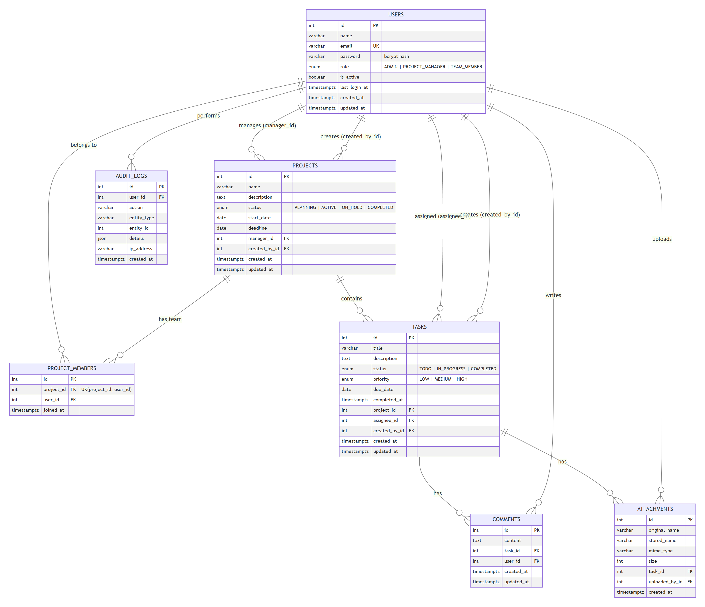
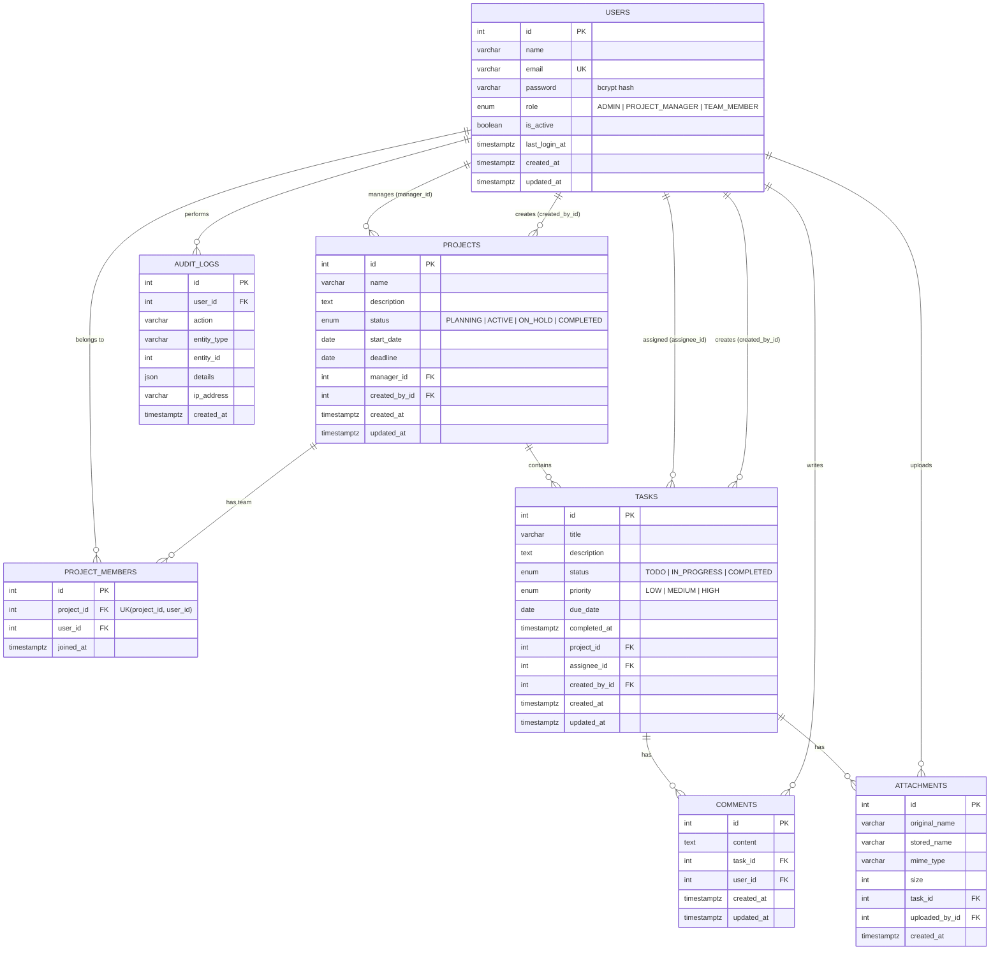

# ER Diagram

> The source below is Mermaid (GitHub renders it automatically).

## Relationships

| Relationship | Cardinality | On delete |
|---|---|---|
| User → Project (manager) | 1 : N | `SET NULL` (project keeps existing, needs a new manager) |
| User ↔ Project (team) via `project_members` | M : N | `CASCADE` (membership row removed) |
| Project → Task | 1 : N | `CASCADE` (deleting a project deletes its tasks) |
| User → Task (assignee) | 1 : N | `SET NULL` (task becomes unassigned) |
| Task → Comment | 1 : N | `CASCADE` |
| Task → Attachment | 1 : N | `CASCADE` (files are also removed from disk) |
| User → AuditLog | 1 : N | `SET NULL` (history is preserved) |

## Design notes

- **Users are soft-deleted** (`is_active = false`) so comments, tasks and audit history keep their author.
- **`project_members` has a unique `(project_id, user_id)`** constraint, so a person can't be added twice.
- **`completed_at`** is maintained by a model hook whenever `status` changes. It powers the "completed vs created" trend chart.
- **Indexes** cover every foreign key used for filtering (`project_id`, `assignee_id`), plus `status` and `due_date` for the task filters and overdue queries.
- **Attachments** store only metadata. The bytes live on disk under a random `stored_name`, so user-supplied filenames never touch the filesystem.
